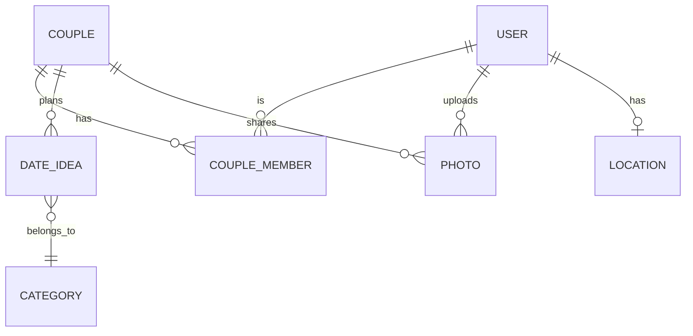

Lastenheft – Ons (Couple Planner App)
Requirements Document · Sep 23, 2026 · @Someone
1. Project Context
Created as part of the semester project "Frameworks for Web-based Application Systems" (TH Brandenburg, Prof. Dr.-Ing. André Nitze). Scenario per the assignment: acting as CTO of a fictional start-up, with the goal of building a working prototype to present to investors ("Business Angel Meetings").

Own product idea, reusable beyond the mandatory university framework: "Ons" – a couple planner for partners in long-distance relationships. Share photos together, plan dates, and organize contact across the distance.
2. Objectives & Scope
- Working, publicly accessible prototype as an MVP for two users (a couple)
- Fully JS/TS-based stack: Vue 3 / Nuxt 3 on the frontend, Node.js on the backend
- Fulfillment of all mandatory requirements from the course brief (see sections 3–5)
- Reusable after submission (not a throwaway prototype) – real use by the author and his partner
- Out of scope: more than 2 users per "couple space", native mobile apps (responsive web only)
3. Functional Requirements
ID	Requirement	Priority	Origin
F1	Couple space via invite code (2 users per space)	Must	Course brief: login/user management
F2	Registration/login (classic + social login)	Must	Course brief
F3	Shared photo gallery/timeline, sorted chronologically	Must	Own idea
F4	Date idea list: create, status (planned/done), category	Must	Course brief: interactive table
F5	Filter/sort/search the date list	Must	Course brief
F6	Map view: both partners' locations + distance/meeting-point suggestion	Must	Course brief: geo information
F7	Countdown to the next meeting	Must	Own idea
F8	Statistics: date categories over time, trend until next meeting	Must	Course brief: data visualization (≥2 chart types)
F9	UI switchable in at least DE/EN/NL	Must	Course brief: multilingualism
F10	Real-time sync (e.g. WebSockets) for new photos/dates	Could (specialization)	Own idea
F11	Push/in-app notifications	Could	Own idea

4. Technical Requirements & Architecture
Frontend: Vue 3 (Composition API) + Nuxt 3/4 (SSR/SSG-capable), TypeScript throughout, Pinia for state management, @nuxtjs/i18n for multilingualism (DE/EN/NL, extensible), Tailwind CSS or UnoCSS for styling.

Backend: Node.js via Nuxt's own Nitro server (single repo, single deployment) or a separate Node/Express/Fastify backend if a decoupled API is preferred. TypeScript throughout.

Database: Supabase Postgres (free tier, incl. Auth/Storage/Realtime) as the primary solution.
Rough data model draft (ER, simplified)

Authentication: Classic login + at least one social login provider. Recommendation: nuxt-auth-utils or Lucia (open source, no vendor lock-in, well-suited for a student project) instead of a paid enterprise solution.

Geo/Map: Leaflet or MapLibre GL JS (open source, no API costs) for location and distance display.

Data visualization: Chart.js or ECharts for at least two chart types (e.g. line chart for countdown/trend, bar/pie chart for category distribution).

Deployment: Vercel (Hobby tier, free) for Nuxt/Nitro – automatic TLS, CI/CD via git push. Custom domain via Cloudflare Registrar (~€8–12/year, at-cost) instead of a *.vercel.app subdomain for a more professional look; DNS also via Cloudflare.
5. Non-Functional Requirements
- Privacy/Security: Private photos and location data between two people – strict access control per couple space, TLS mandatory (even though the course brief lists it as optional), password hashing (bcrypt/argon2), rate limiting on auth endpoints.
- Responsive design: Fully usable on desktop and mobile (mobile prioritized, since everyday use is mostly mobile).
- Multilingualism: UI language switchable, initial language from browser locale, fallback DE.
- Performance: Images delivered compressed/optimized (e.g. Nuxt Image), gallery load time acceptable even with many photos.
- Maintainability: Language-agnostic, extensible data model (no hardcoded per-language columns), so the project can keep growing after submission without refactoring.
6. Specialization (for bonus points/course requirement)
Proposal: Real-time integration – Supabase Realtime (Postgres change subscriptions) for live updates when a partner uploads a photo or changes a date, without running a custom WebSocket server. Fulfills the course requirement "complex integration with external services" or "special visualization/business logic" and makes sense for the use case (long-distance relationship = simulating real-time closeness).

Alternative/addition: test automation (Cypress/Playwright) for the core flows (login, creating a date, uploading a photo).
7. Evaluation Criteria (reference from course materials)
Area	Criterion	Points
Architecture & technology use	Framework use, layering, data modeling	25
Functional implementation	Auth, external integration, consistent demo	25
UI & usability	Responsive, state management, layout	15
Deployment & operations	Publicly available, error handling/security	10
Specialization	Chosen deep-dive (see section 6)	15
Teamwork & quality	Git workflow, documentation, code quality	5
Reflection & presentation	Justified framework choice, lessons learned	5
Total		100
Bonus	Visual quality, usability, feature scope	up to +20

8. Open Points & Assumptions
Decided
- Monorepo with Nuxt/Nitro (no separate Node backend)
- Hosting: Vercel (frontend + backend) + Supabase (DB/Auth/Storage/Realtime) – both free on the free tier
- DB engine: PostgreSQL via Supabase
- Social login: Google via Supabase Auth
- Domain: own domain via Cloudflare Registrar (~€8–12/year)
Still open
- Third UI language beyond DE/EN/NL? (optional)
- Exact domain name
9. Design & Branding
Aim: not a generic SaaS-template look (standard rounded cards, interchangeable gradient hero), but a distinct visual identity that fits the product – close, personal, not corporate-tool-like.

Custom assets: Logo and illustrations will be created by the partner (graphic designer/digital artist) – own wordmark/icon, possibly an illustration set for empty states (e.g. "no shared photos yet", "no date planned yet") instead of a generic icon library.
Design system (derived from the custom assets)
- Color palette derived from the logo/illustrations, not from a standard preset
- Typography: one distinctive headline typeface + one highly legible body typeface, a clear type scale instead of default Tailwind sizes
- Consistent spacing/radius tokens, centrally maintained in Tailwind config or CSS variables (Nuxt: assets/css/tokens.css or Tailwind theme extension)
- One deliberate hero moment on the homepage (e.g. illustration instead of standard stat tiles), rest of the UI restrained
Workflow: Partner delivers assets (SVG/PNG) → integrated as components/icons in the Nuxt project, versioned in the repo under assets/illustrations/. Figma handoff for exact dimensions/colors if needed.

Relation to evaluation: directly contributes to "UI & Usability" (section 7) as well as the bonus point "high visual quality, particularly appealing design".
10. Team & Roles
Two-person team, implementation has not started yet (no code written so far). Role split still open – to be clarified before section 1 ("Teams & Topics", October).
Area	Responsible	Note
Frontend (Nuxt/Vue)	TBD	
Backend/DB (Nitro, Supabase)	TBD	
Design/Assets	Partner (external to the university team)	provides logo/illustrations, not a course team member
Deployment/Infra	TBD	

Evaluation criterion "Teamwork & Quality" (section 7) requires a Git workflow – define a branching strategy (e.g. main + feature branches, PR review) before the project starts.
11. Timeline & Milestones
Per the course overview (seminar format: lecture → exercises → reflection, 5 ECTS, 60h in-class + 90h self-study):
Period	Milestone	Deliverable
October	Teams & Topics	Team formed, product idea + tech stack fixed
November	Business Angel Meeting I	Drafts (UI mockups, data model, architecture)
December	Business Angel Meeting II	Working prototype (core features F1–F9)
January	Pitch	Final presentation + submission, one short talk per person

Current status: preparation phase (requirements/architecture clarified, implementation not yet started) – realistically ahead of "Teams & Topics" in October.
12. Test Strategy
- Unit tests: Vitest for composables/business logic (natively integrated in Nuxt)
- Component tests: Vue Test Utils + Vitest for critical components (date list, photo upload)
- E2E tests: Playwright for core flows (login, create date, upload photo, switch language) – aligns with the optional "Tests" specialization from section 6, if chosen
- CI: GitHub Actions, tests run on every pull request before merging into main
